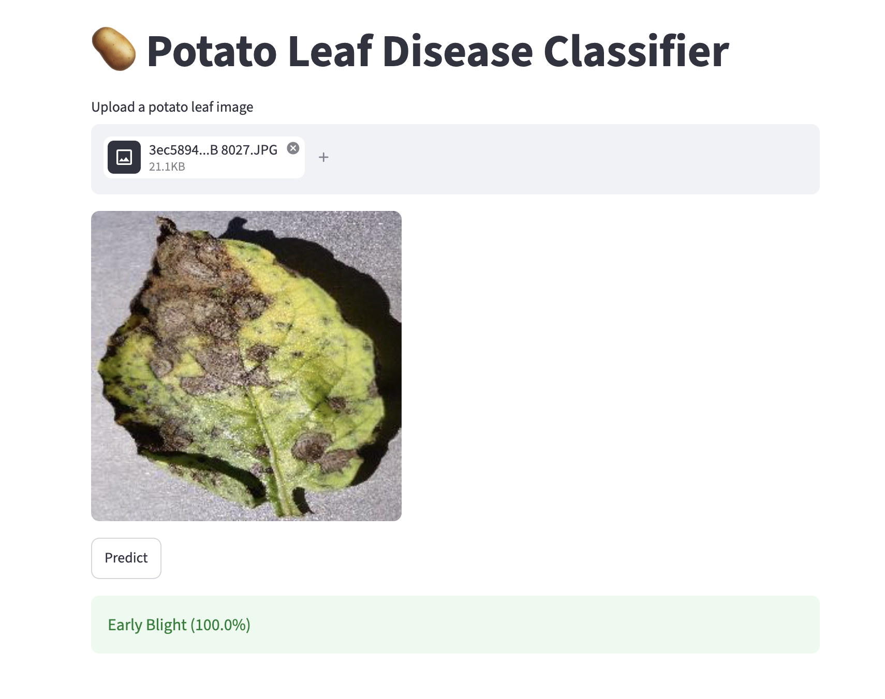
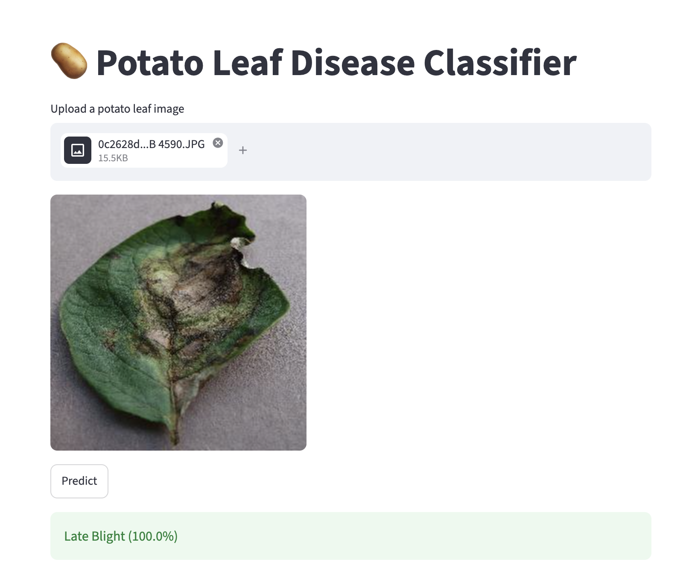
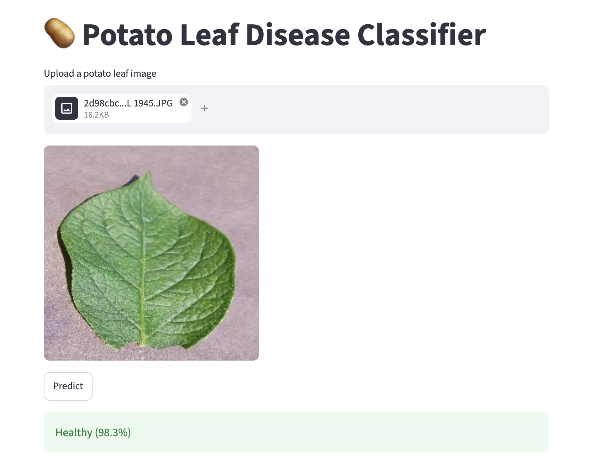
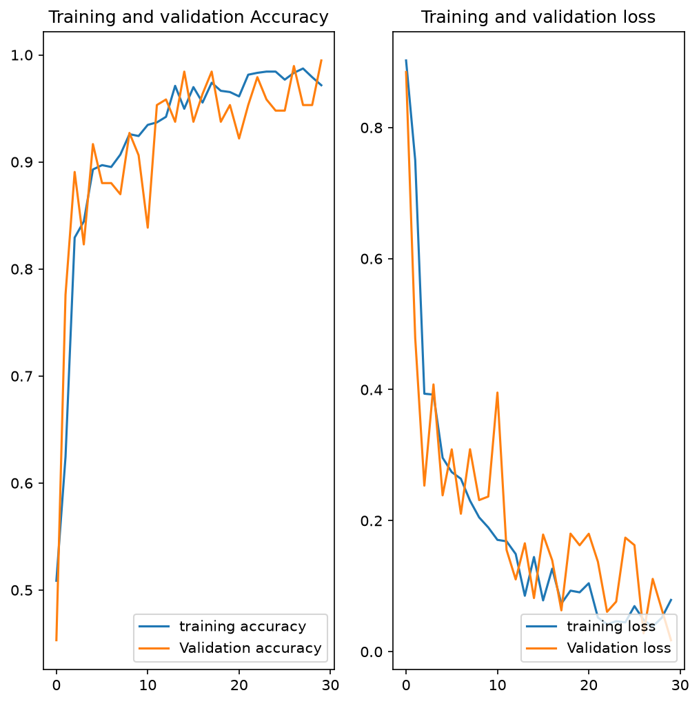
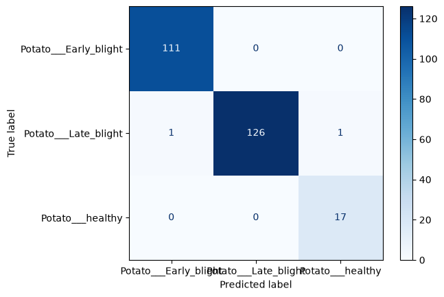
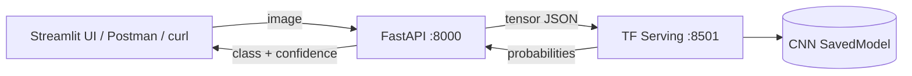

# 🥔 Potato Leaf Disease Classification

A deep learning project that classifies potato leaves as **Early Blight**,
**Late Blight** or **Healthy** using a CNN. The model is served with
**TensorFlow Serving** behind a **FastAPI** gateway, with a **Streamlit** interface.

## Demo

| Early Blight | Late Blight | Healthy |
|---|---|---|
|  |  |  |

## Results

| Metric | Value |
|---|---|
| Test accuracy | **99.2%** (loss 0.029) |
| Final validation accuracy | 99.5% |
| Final training accuracy | 97.2% |
| Epochs | 30 (Adam, batch size 32) |
| Input size | 256×256 RGB |





> Evaluated on a small held-out test set (8 batches, roughly 230–250 images) of
> lab-style PlantVillage photos. Validation accuracy fluctuates between epochs,
> and accuracy on real field photos is likely lower.

## Architecture



FastAPI handles pre-processing (decode, convert to RGB, resize) and
post-processing (probabilities → label). TF Serving is a pure inference
engine that loads the SavedModel and handles model versioning.

## Dataset

[PlantVillage](https://www.kaggle.com/datasets/arjuntejaswi/plant-village),
potato subset: **2,152 images**, 3 classes (`Potato___Early_blight`,
`Potato___Late_blight`, `Potato___healthy`).

The classes are imbalanced: the healthy class is much smaller than the two
disease classes, so check the confusion matrix and not only the global accuracy.

Split (by batches of 32): **54 train / 6 validation / 8 test** (80 / 10 / 10 %).

Data augmentation (training only, built into the model): random horizontal and
vertical flips, random rotation (±20 %).

To rerun the notebook, download the dataset and place the potato folders in
`training/PlantVillage/`.

## Model

A CNN built with Keras `Sequential` (183,747 parameters, about 0.7 MB):

- `Resizing(256, 256)` + `Rescaling(1/255)`, so the exported model takes raw 0–255 pixels
- Data augmentation (flip, rotation)
- 6 × [`Conv2D` (32 then 64 filters, 3×3, ReLU) + `MaxPooling2D` (2×2)]
- `Flatten` → `Dense(64, ReLU)` → `Dense(3, softmax)`
- Loss: `SparseCategoricalCrossentropy`, optimizer: Adam

Notebook: [`training/training.ipynb`](training/training.ipynb)

## Project structure

```
├── api/            FastAPI gateway
├── frontend/       Streamlit app
├── models/1/       Exported SavedModel (version 1, TF Serving convention)
├── training/       Training notebook
├── assets/         Screenshots and plots
└── models.config   TF Serving configuration
```

## How to run

**Prerequisites:** Python 3.11, Docker

```bash
pip install -r requirements.txt
```

**1. Start TF Serving** (from this folder; on Apple Silicon add `--platform linux/amd64`)
```bash
docker run -t --rm -p 8501:8501 \
  -v "$(pwd)":/potato-disease \
  tensorflow/serving \
  --rest_api_port=8501 \
  --model_config_file=/potato-disease/models.config
```

**2. Start the API**
```bash
cd api && uvicorn main:app --reload
```

**3. Start the interface**
```bash
streamlit run frontend/app.py --server.port 8502
```

### Or call the API directly

```bash
curl -X POST http://localhost:8000/predict -F "file=@leaf.jpg"
```
```json
{"class": "Early Blight", "confidence": 0.99}
```
Interactive docs: http://localhost:8000/docs

## Limitations and future work

- Trained on lab-style images; field photos may reduce accuracy
- Small test set and imbalanced classes, so the metrics have a wide margin of error
- Planned: Dockerfile / docker-compose for one-command startup, online deployment

## Credits

Built following the Codebasics "Potato Disease Classification" end-to-end deep
learning tutorial. Added on top of the tutorial: Streamlit frontend (instead of
React), SavedModel signature workaround, `models.config` setup, and the
confusion-matrix evaluation.